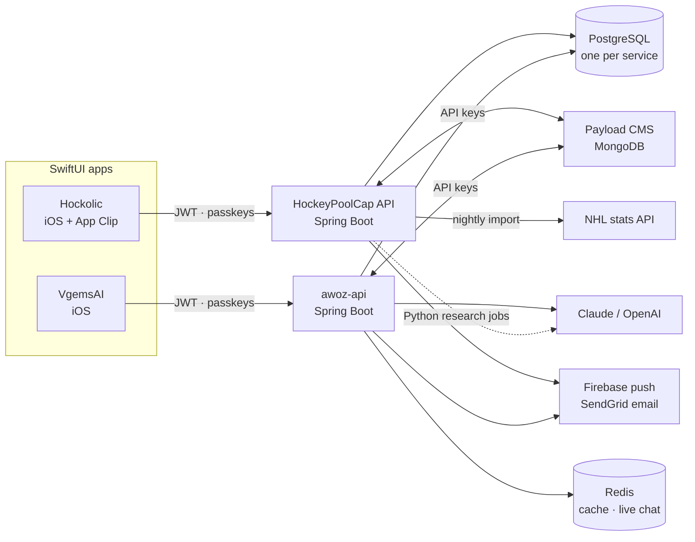

<div align="center">

# Hi, I'm Oskar Wong 👋

### Senior Software Engineer | Java & Spring Boot | SwiftUI & iOS | AWS & Kubernetes | AI Integration

**I design and build backend services, cloud infrastructure, and Apple-platform apps—from architecture to production.**

[](https://github.com/atorpos)


[](https://www.linkedin.com/in/oskarwong/)

**📲 My apps on AppStore**

[](https://testflight.apple.com/join/PSfs8fSa)

**📲 Try my apps on TestFlight**

[](https://testflight.apple.com/join/QWttPQvB)

</div>

---

## 👨‍💻 About me

I'm a **Senior Software Engineer** working across **backend services, mobile applications, and cloud infrastructure**. My background spans enterprise software, fintech, telecom, and independent product development.

I enjoy connecting the pieces: designing APIs, building the data layer, deploying the infrastructure, and delivering a great experience on the device in someone's hand.

- ⚙️ **Backend:** Java, Spring Boot, Node.js, TypeScript, REST, GraphQL
- ☁️ **Cloud & DevOps:** AWS, Docker, Kubernetes, CI/CD, Redis
- 📱 **Apple platforms:** Swift, SwiftUI, iOS, watchOS, SwiftData, CloudKit
- 🤖 **AI-enabled products:** document workflows, intelligent assistants, and business automation
- 🧭 **Approach:** practical architecture, thoughtful UX, security, and maintainability

## 🚀 Featured work

<table>
  <tr>
    <td width="50%" valign="top">
      <h3>⌚ LockinMinder</h3>
      <p><strong>A wrist-first companion for combination locks.</strong></p>
      <p>Save combinations, remember lock locations, sync between iPhone and Apple Watch, and use Live Activities to keep important information close.</p>
      <p>
        
        
        
      </p>
      <p>👉 <a href="https://testflight.apple.com/join/PSfs8fSa"><strong>Join the LockinMinder beta on TestFlight</strong></a></p>
    </td>
    <td width="50%" valign="top">
      <h3>🏒 Hockolic</h3>
      <p><strong>Hockey analytics meet fantasy decision-making.</strong></p>
      <p>Explore NHL teams, players, contracts and salary caps; experiment with mock trades and fantasy roster decisions through an iOS app (with an App Clip) backed by the <strong>HockeyPoolCap API</strong>.</p>
      <p>
        
        
        
      </p>
      <p>👉 <a href="https://testflight.apple.com/join/QWttPQvB"><strong>Join the Hockolic beta on TestFlight</strong></a></p>
    </td>
  </tr>
  <tr>
    <td width="50%" valign="top">
      <h3>💎 VgemsAI</h3>
      <p><strong>A smarter B2B experience for gems and jewelry.</strong></p>
      <p>An AI-enabled platform connecting industry workflows: company discovery, event and exhibitor data, business conversations, and document handling. Powered by the <strong>awoz-api</strong> backend.</p>
      <p>
        
        
        
      </p>
    </td>
    <td width="50%" valign="top">
      <h3>🧩 Java API Platforms</h3>
      <p><strong>Backend architecture designed for real applications.</strong></p>
      <p>Spring Boot services for business and sports applications, with authentication, SQL persistence, caching, external data integration, and cloud deployment workflows. See the project structures below.</p>
      <p>
        
        
        
      </p>
    </td>
  </tr>
</table>

<sub>Some product repositories are private. This section highlights the product goals and engineering disciplines rather than linking to inaccessible source code.</sub>

## 🏗 Under the hood: backend architecture

Both apps above run on Spring Boot services I designed and operate myself. They share the same foundation (**Spring Boot 4.1 · Java 21 · PostgreSQL · Flyway · JWT**), shipped with Docker Compose behind Nginx on AWS, and a Payload CMS for content and admin screens.



### 🏒 HockeyPoolCap API — the backend behind Hockolic

- **NHL data pipeline:** a scheduled nightly import of teams, rosters, prospects, stats, standings and game results.
- **Salary-cap engine:** contracts with retained salary, cap charges, LTIR, per-season cap ranges and team cap summaries.
- **Fantasy & hockey insights:** fantasy leagues and points, draft-pick ownership, injuries, and player career pages.
- **AI-assisted research:** Python scripts use Claude with web search to gather what the NHL doesn't publish (contracts, trades, injuries) and feed it back through admin endpoints.
- **Security:** passkeys (WebAuthn), email two-step sign-in, field-level encryption of personal data, and role/API-key protected admin routes.

<details>
<summary><strong>📁 Project structure</strong></summary>

```text
hockeypoolcap-api/
├── src/main/java/com/hockeypoolcap/api/
│   ├── auth/ passkey/ user/ member/   # sign-up, JWT, passkeys, 2-step codes, CMS profile sync
│   ├── team/ player/ season/ career/  # NHL teams, rosters, prospects, career stats
│   ├── cap/ draft/ injury/            # salary cap & LTIR, draft-pick ownership, injuries
│   ├── game/ importer/                # nightly NHL import, game results, App Clip arena pages
│   ├── fantasy/ demo/                 # fantasy leagues & points, App Review demo account
│   ├── push/ email/                   # Firebase push (game recaps), SendGrid email
│   └── common/ config/                # security filters, encryption, error handling
├── src/main/resources/db/migration/   # Flyway schema migrations (PostgreSQL)
├── src/test/                          # Spring Boot tests on H2 (PostgreSQL mode)
├── scripts/research/                  # Python + Claude: contracts, trades, injuries, draft picks
├── deploy/                            # Docker Compose, Nginx config, setup & deploy scripts
├── docs/wiki/                         # architecture, runbook, salary-cap rules, decisions
└── Dockerfile · compose.yaml · pom.xml
```

</details>

### 💎 awoz-api — the backend behind VgemsAI

- **AI assistant:** a provider-agnostic chat layer (Claude or OpenAI) with per-plan token allowances and rate limits, for the app and the website.
- **B2B business chat:** company workspaces, encrypted document attachments, e-signature requests with an audit trail, and Redis for live events across instances.
- **Automated data jobs:** weekly AI-driven trade-show discovery, exhibitor-list extraction and enrichment, commodity price updates, and drafted market-news articles.
- **Security:** JWT, passkeys, new-device login codes, and field-level encryption of personal data.

<details>
<summary><strong>📁 Project structure</strong></summary>

```text
awoz-api-in-javasb/
├── src/main/java/co/awoz/awozapi/
│   ├── auth/ user/ devices/ review/      # JWT, passkeys, new-device codes, App Review account
│   ├── companies/ clients/               # B2B company workspaces, client sync with the CMS
│   ├── chat/                             # AI assistant (Claude / OpenAI), allowances, rate limits
│   ├── messaging/                        # business chat, encrypted attachments, e-signatures
│   ├── events/ exhibitors/               # AI trade-show discovery, exhibitor extraction & enrichment
│   ├── products/ market/ marketnews/     # product catalog, commodity prices, AI market news
│   ├── push/ email/                      # Firebase push, SendGrid email
│   └── common/ config/                   # security, Redis cache, scheduled jobs, error handling
├── src/main/resources/db/migration/      # Flyway schema migrations (PostgreSQL)
├── src/test/                             # Spring Boot tests on H2 (PostgreSQL mode)
├── python/exhibitors/                    # exhibitor-list extraction tooling
├── deploy/                               # Docker Compose, Nginx, deploy & data-job scripts
├── docs/wiki/                            # architecture, API map, feature guides, operations
└── Dockerfile · compose.yaml · pom.xml
```

</details>

<sub>Both repositories are private; their structure is shared here to show how I organize production services by business domain.</sub>

## 🛠 Engineering toolbox

**Backend & APIs**


**iOS & watchOS**


**Data, infrastructure & delivery**


**AI & integrations**


## 🧠 How I approach engineering

| Focus | What matters to me |
| :--- | :--- |
| **Architecture** | Clear service boundaries, maintainable APIs, and components that can evolve independently |
| **Reliability** | Observability, sensible caching, robust error handling, and reproducible deployments |
| **Product** | Useful features, understandable interfaces, and feedback-driven iteration |
| **Security** | Thoughtful authentication, data access, and privacy-aware design |

## 📬 Connect

I'm interested in challenging engineering problems, useful products, and conversations about backend systems, Apple-platform development, and AI integrations.

[](https://www.linkedin.com/in/oskarwong/)
[](https://github.com/atorpos?tab=repositories)
[](https://testflight.apple.com/join/QWttPQvB)
[](https://testflight.apple.com/join/PSfs8fSa)

Want to learn more about my career experience? **[Visit my LinkedIn profile](https://www.linkedin.com/in/oskarwong/)**.

---

<div align="center">
  <sub>Build thoughtfully. Ship useful things. Keep improving.</sub>
</div>
